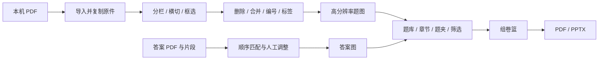

# Mac 开发接手计划与项目现状

> **实施更新（同日 beta.4）：** 已完成本机兼容升级与回归，并继续修复旋转页三处信息丢失、答案配对持久化。当前运行栈为 Electron 44.9.3 / better-sqlite3 13.0.3 / Node 24；新增 Apple Silicon DMG 发布目标和 Mac 打包验收。详见 [beta.4 交付记录](../specs/2026-10-23-mac-beta4-release.md)。下文是首次接手时的审阅快照，其中“运行时被阻塞”“尚未修改源码”等已被此更新替代；Windows 复测、真实资料迁移、可编辑题目和 Word 导出仍待推进。

核查日期：2026-10-23（北京时间）。代码基线：`main`，`50eb217340d99b41cbd5ed7c75a63d5bc6af201c`，版本 `1.1.0-beta.3`。本次目标是理解项目、恢复本机开发条件、给出后续执行计划；以下待办不代表已经实施。

## 1. 接手结论

项目已经有完整的图片题库业务主线，可以在现有基础上继续开发。当前阶段是 **先解决 Mac 运行时兼容阻碍，再验收 beta.3 并准备可编辑题目**，不是从头搭建项目。用户明确后续以这台 Mac 作为开发机；Mac 兼容性是开发基线要求。

- 已实现：PDF 导入、人工分栏/横切/框选、跨页合并、题图入库、标签、答案导入和匹配、个人题夹、组合检索、批量选题、组卷、PDF/PPTX 导出。
- 最新增量：PDF 拖放导入、人教版（2019）六册章节模板、知识点搜索多选、题库整理体验。
- 尚未实现：OCR 正文检索、文字/公式编辑、独立配图编辑、Word 导出、完整组卷排版预览、拼图片段的手动位置微调。
- 已有后续顺序：**先验收分类检索和选题 → 可编辑题目、排版和 Word → 统一导航布局**。本次延续这个顺序，不把全面重构列为新功能前置条件。
- 源码与题库数据分开：本机已取得源码；Windows 上的真实数据库、PDF、题图尚未迁入。
- 本机实际发现：锁定的 Electron 31.7.7 被 macOS 安全检查拦截并移入废纸篓。类型检查和构建通过，但 GUI 尚不能启动，不能称为“Mac 环境全部就绪”。

不使用单一“完成百分比”：图片题库主线与可编辑题库的范围不同。前者已交付测试版，后者仍在调研和方案阶段。

## 2. 已有进度说明、计划与发布证据

| 阅读顺序 | 文档 / 入口 | 应如何使用 |
|---|---|---|
| 1 | [README](../../../README.md) | 当前功能、启动方式、最新版本 |
| 2 | [后续执行目录](2026-10-22-execution-roadmap.md) | 后续功能优先级的主入口 |
| 3 | [开发日志](../specs/2026-07-06-development-progress.md) | 文件名虽是 7 月，顶部已更新到 10 月 23 日；正文保留历史快照 |
| 4 | [beta.3 章节与知识点记录](../specs/2026-10-23-chapter-templates.md) | 最新交付范围和 Windows 验证边界 |
| 5 | [拖放修复](../specs/2026-10-23-drag-import-fix.md)、[beta.1 交付记录](../specs/2026-10-23-test-release.md) | 近期修复及发布过程；beta.1 文档不是 beta.3 的最终状态 |
| 6 | [10 月 22 日接手计划](2026-10-22-project-takeover-plan.md) | M17 后代码核查与遗留问题；其中“只有旧安装包”“79 个测试”已被后续交付更新 |
| 7 | [可编辑题目技术调研](../specs/2026-10-22-editable-question-solutions-research.md) | 第二阶段候选方案；没有真实样本效果比较，不能视为选型已定 |
| 8 | [原始需求](../specs/2026-07-06-physics-question-bank-requirements.md)、[技术设计](../specs/2026-07-06-physics-question-bank-technical-design.md) | 理解人工拆题和图片保真的设计；早期“不做 OCR”限定第一阶段，不否定后续可编辑副本 |

远端核查：仓库为私有；本次查询只有 `main` 分支，Issues 和 PR 列表为空；进度主要记在仓库文档。最新提交时间为 2026-10-23 13:03:08，Releases 的 beta.3 发布时间为当天 13:09:12。

[GitHub beta.3 发布页](https://github.com/chengyingzh433-stack/physics-question-bank/releases/tag/v1.1.0-beta.3) 已存在，指向本次代码基线，附带 Windows 安装包 `physics-question-bank-1.1.0-beta.3-setup.exe`（126,555,279 字节）、校验和及验证报告。这里确认的是远端发布记录和附件存在，不是本机运行过该 Windows 安装包。

历史日志中的 M16/M17“待开工”、完成弹窗“延期”等旧段落不能直接当成当前待办：PPT 导出和完成弹窗已有代码；M17 只完成部分批量查询优化。

## 3. 项目结构和关键业务约定

技术栈为 Electron + React + TypeScript + Mantine + SQLite。依赖版本以 `package-lock.json` 为准，本次安装的 Electron 为 31.7.7、better-sqlite3 为 11.10.0。它是本地桌面程序，没有需要另外部署的业务服务器、云数据库或账号系统。



| 层或模块 | 主要入口 | 接手要点 |
|---|---|---|
| 主进程和窗口 | `src/main/index.ts` | 初始化数据库、协议与 IPC；单实例、启动失败提示、Mac 关闭窗口后保留应用逻辑 |
| 进程通信 | `src/preload/index.ts`、`src/shared/types.ts`、`src/main/ipc/index.ts` | `window.api` 是渲染层与存储层的契约；新增能力需同步修改三处 |
| 存储与迁移 | `src/main/storage/StorageService.ts`、`schema.ts`、`repositories/` | SQLite WAL；外键级联；当前通过检查列是否存在做幂等升级，`schema_meta` 尚未形成完整的版本迁移序列 |
| 文件导入与读取 | `src/main/files/importPaper.ts`、`FileService.ts`、`ImportService.ts` | 主进程复制 PDF；渲染层解析页信息；`app://projects/...` 提供本地资源 |
| PDF 与裁切 | `PDFViewer.tsx`、`CropOverlay.tsx`、`CropView.tsx`、`useCropData.ts`、`ColumnCropService.ts` | 几何采用 0–1 比例坐标；缩放不改变裁切数据；按页/列/位置派生片段 |
| 后期处理与出图 | `PostProcessView.tsx`、`PostProcessService.ts`、`QuestionRenderService.ts`、`RenderService.ts` | 删除是片段软删除；合并关系独立保存；入库从原 PDF 按 DPI 重绘，不能放大预览缩略图 |
| 原卷复查与模板 | `PaperReviewView.tsx`、`TemplateView.tsx`、`TemplateService.ts` | 题型模板按题号区间应用；复查页在入库后开放 |
| 答案流程 | `AnswerMatchView.tsx`、`AnswerMatchService.ts`、`WorkflowLayout.tsx` | 答案卷复用试卷、页和片段模型，通过 `kind='answer'` 隔离；答案图挂在题目卷的题目行上 |
| 题库和分类 | `BankView.tsx`、`questionFilter.ts`、`folderRepo.ts` | 同题可入多个单层题夹；条件 AND，多个知识点匹配任一；搜索元数据，不识别题图正文 |
| 章节与知识点 | `shared/chapterTemplates.ts`、`storage/chapterTemplates.ts`、`tagRepo.ts`、两个 Picker | 六册、27 章、125 节，共 158 节点；章节父节点筛选含后代；预设幂等安装，保留旧 ID |
| 组卷导出 | `BasketView.tsx`、`setRepo.ts`、`ExportService.ts`、`ExportServicePpt.ts` | 当前以单个持久化草稿篮为主；PDF/PPT 三种答案位置；PPT 题号文本可编辑，但题干仍是图片 |
| 验证与交付 | `src/**/*.test.ts`、`scripts/*smoke*`、`test-packaged-app.mjs`、`electron-builder.yml` | 单测、内存数据库测试、隔离 GUI、Windows 发布程序验证是不同层次 |

数据库关系：`papers → pages → segments → question_segments → questions`；题目另关联题型、章节、难度、知识点、题夹和组卷条目。`papers.parent_paper_id` 连接答案卷与题目卷。`order_index` 是页内顺序，跨页排序必须先比较 `page_index`。

年份和出处使用“试卷默认值 + 单题覆盖”，由 SQL 的 `COALESCE` 统一计算。题库只接收 `image_path` 非空且来自题目卷的题，不能把答案卷的中间合并组混入题库。

## 4. 本次 Mac 验证

本机：Apple Silicon / arm64，macOS 26.6；Node 24.22.1、npm 11.19.1、Git 2.56.0、Python 3.14.8。GitHub CLI 已登录仓库所属账号。源码目录：`/Users/metric/有趣的项目/教师题库`。

以下为本轮实际执行结果，详细证据见 [Mac 接手验证记录](../specs/2026-10-23-mac-takeover-validation.md)。

| 检查 | 本轮结果 |
|---|---|
| 拉取源码 | 已完成，基线 `50eb217` |
| `npm ci` | 已完成，按锁文件安装 540 个包 |
| `npm run typecheck` | node/web 均通过 |
| `npm run build` | main/preload/renderer 均通过 |
| `npm run rebuild` | 命令成功，SQLite 原生文件为 Mach-O arm64；不代表运行时加载成功 |
| `npm test` | 8 个文件、99 项中 79 项通过；20 项依赖 Electron 的数据库测试失败，见下方原因 |
| `npm run test:bank-ui` | 未执行；前序测试失败中止串行命令，且 Electron 已被系统移除 |
| `npm run test:chapters-ui` | 未执行；同上 |

**兼容阻碍已定位到系统日志：** 19:58:30 的 `syspolicyd` 记录 `Attempting to move malware to trash`，之后 `Evaluating blocked code`；本机 `~/.Trash/Electron.app` 存在，项目内对应应用已不存在。Electron 下载压缩包的 SHA-256 与 npm 包提供的 `checksums.json` 一致。这说明本机确实拦截了该运行时，不足以证明拦截的具体检测依据，也不能据此认定项目业务源码有恶意行为。本轮没有恢复被拦截程序或降低系统保护。

构建保留已有的 `RenderService.ts` 同时静态/动态导入提示，不阻断构建。安装审计返回 34 项依赖告警（5 moderate / 26 high / 3 critical）；尚未逐项核定生产可达性。应单独安排依赖升级验证，不直接运行强制修复改写全部锁定版本。

本轮不以 Mac 构建代替 Windows 安装验收，不以自动化示意题测试代替真实教学资料验收。

## 5. 这台电脑如何继续开发

**当前先完成第 8 节 A0，以下是兼容基线修复后的日常启动方式；本轮尚未验证能成功打开窗口。**

```sh
cd '/Users/metric/有趣的项目/教师题库'
npm run dev
```

重新克隆、更新锁文件或切换 Electron/CPU 架构后，按以下顺序重新准备：

```sh
npm ci
npm run rebuild
npm run typecheck
npm test
npm run build
npm run test:bank-ui
npm run test:chapters-ui
```

`better-sqlite3` 需要与 Electron 的 ABI 和 arm64 架构匹配；不要从 Windows 复制 `node_modules`，也不要把“本机 Node 能加载 SQLite”当作“Electron 能加载”。本项目数据库测试会启动 Electron 的 Node 模式。升级后按 [Electron 原生模块说明](https://www.electronjs.org/docs/latest/tutorial/using-native-node-modules) 重建并做加载验证。

Mac 开发和 Windows 发布分开管理：

- `.bat`、`.vbs`、PowerShell 快捷方式脚本用于 Windows；Mac 从开发命令启动。
- `electron-builder.yml` 定义了 Windows NSIS x64 发布流程，没有项目专用的 Mac 打包、签名、公证及验收配置。能在 Mac 开发不代表已交付 Mac 安装版。
- `scripts/test-packaged-app.mjs` 硬编码 Windows EXE，不能直接拿来验收 Mac 应用。README 的 `npm run dist` 在 Mac 上不应被理解为“已验证的 Windows 发布命令”。
- 后续 Windows 安装包应在 Windows 机器或经配置的 Windows CI 上构建和验证；本机 GUI 回归负责跨平台开发反馈。Mac 可安装版本若确有需要，再单列打包任务。
- 仓库未发现 CI 工作流或 Node 版本约束文件。下一次开发可补跨平台检查与已验证版本说明，避免两台电脑依赖环境漂移。

## 6. Windows 题库数据迁移方案

### 需要带过来的内容

1. Windows 应用的完整用户数据备份。README 的默认位置为 `%APPDATA%/physics-question-bank`，数据库文件为 `app.db`。
2. 应用设置中显示的实际项目目录，含每份试卷的 `source.pdf` 和 `images/` 下的题图、答案图。若曾改过存储位置，这部分可能不在用户数据目录中。
3. 若 Windows 工作区还有未提交或未推送的源码，也需先同步；本次只能确认 GitHub 上的状态，无法证明另一台电脑没有额外改动。

### 迁移顺序与验收

- 完整退出 Windows 应用后复制用户数据和项目目录，保留原件不动。不要在应用运行时只复制 `app.db` 而忽略 WAL；“备份数据库”按钮是数据库快照，不包含 PDF/PNG。
- 先在 Mac 的独立测试副本中恢复。默认用户数据位置预计为 `~/Library/Application Support/physics-question-bank/`，应以实际运行时的 `app.getPath('userData')` 为准。
- 检查备份中 `app_settings.storage_path`。若是 `D:\...` 一类 Windows 路径，不能直接沿用；在副本上指向复制后的 Mac 项目目录，或恢复为默认 `projects/`。不要通过现有“更改位置”功能盲目把一个不存在的 Windows 源目录当成成功迁移。
- `papers.source_pdf_path` 也保存绝对路径；实际查看主要由 `app://` 和动态项目根目录解析，但迁移时仍应统一修正这些历史字段，避免后续功能读到旧路径。图片字段保存的 `projects/...` 相对引用应保持一致。
- 对比试卷数、题目数、答案图数、题夹、知识点和组卷篮；抽样打开原 PDF、跨页题和答案，重启后复查，再做一次 PDF/PPT 导出。
- 验收通过才切换日常使用目录。当前没有内置整库恢复向导或跨电脑双向同步，不能让两台机器并发修改同一份 SQLite 数据文件。

**当前状态：真实数据未提供，迁移未执行。这不阻挡在空白/临时库中继续开发。**

## 7. 优先问题清单：事实与待复现分开

下表是本次静态审阅与已有接手记录的合并结果。除写明“复现”外，只说明代码机制或风险，不宣称用户已经遭遇故障。修复时先用样本定位，再改最小范围。

| 优先级 | 问题与依据 | 建议验收 |
|---|---|---|
| P0，Mac 开发前 | 本机实际拦截 Electron 31.7.7，20 项数据库测试无法完成，GUI 未运行 | 升级到经本机验证的官方运行时，确认窗口/SQLite/PDF/IPC 正常；保留系统安全保护；通过全部测试和两套 GUI 回归 |
| P0，迁移真实资料前 | 备份只有数据库；`FileService.migrateStorage` 只比较路径字符串，没有充分检查父子目录/目标冲突；复制后先改设置再删旧文件，删除失败不具备完整回滚 | 用临时目录测试同路径、父子路径、目标冲突和失败回滚；完成数据库+资源的恢复演练 |
| P1，首批修复 | 旋转信息有三处断点：`ImportService` 传入 rotation，但 `paperRepo.addPages` 未写该列；题目出图的 `PostProcessView` 和答案出图的 `AnswerMatchView` 均未把 rotation 放入页面映射 | 0°/90°/180°/270° PDF 从导入、预览、裁切到最终题图/答案图方向和区域一致；修复需覆盖三处而非只改答案页 |
| P1，首批修复 | `AnswerMatchView` 的手动配对只在 React state 中，重载会自动顺序配对；落库的是答案图，没有题目—答案片段配对表 | 手动交换答案、保存、退出、重进、再次保存后仍保持原配对；无答案题不能被错误覆盖 |
| P1，输出验收前 | PPT 题图上界 `1.2+4.5=5.7`、inline 答案 `1+5=6`，均可能超过页高 5.625；append 在放图后才判断换页 | 长题/长答案不越界；无答案或末项满页不产生多余答案续页；在 WPS/PowerPoint 打开检查 |
| P1，输出验收前 | PDF 先写题号/分组标题再决定题图换页；PDF/PPT 对部分缺图读取失败仍继续导出 | 题号随题图分页；缺题图必须明确告知，不能无提示当作完整成功 |
| P1，编辑旧题前 | 重新裁切会替换 segments，外键级联删除已有 question_segments；合并/取消合并会删除旧 question 行，关联的标签、题夹、答案和组卷引用需要验证 | 对已入库、已归类、已入篮的题测试重裁/重合并，明确保留规则和提示；不能只验证新卷首次录入 |
| P1，发布维护 | 依赖审计已有告警；Electron/pdfjs 曾有兼容问题 | 分清生产/构建依赖并制定升级分支；升级后回归 PDF worker、SQLite ABI、导出及安装包 |
| P2，随需求处理 | 后期页 1146 行、答案页 734 行；逐题读取片段和知识点仍存在；题库分页是先查全部再前端切 24 条 | 先测大题库与长试卷耗时，再局部拆分、批量读取或数据库分页；不先重写全应用 |

此外，答案导入失败后的回滚不如主页导入完整，组卷标题/答案模式目前只在页面状态中。这些可纳入真实资料走查，按实际影响确定修复顺序。

## 8. 后续执行计划与完成标准

### A0. 建立 Mac 可运行的兼容基线（最高优先级）

1. 单独建立兼容升级分支，保留 `v1.1.0-beta.3` 作为 Windows 参考基线；本次先交付核查和计划，没有改写产品依赖或宣布升级成功。
2. 从官方仍维护的稳定分支选择候选并固定精确版本。2026-10-23 [官方发布页](https://releases.electronjs.org/)列出 45.0.0、44.9.3、43.8.3；可先评估 44.9.3，再根据本机运行和迁移成本确定最终版本。这是待验证候选，不是已验证推荐。执行时复核最新维护状态。
3. 核对 [Electron Breaking Changes](https://www.electronjs.org/docs/latest/breaking-changes)，同时评估 `better-sqlite3`、`@electron/rebuild`、electron-vite/toolkit 和打包工具的兼容组合。记录 Node 与内置 Electron Node 的区别，补固定开发版本文件。
4. 验证 `sandbox:true` 的 preload、`contextBridge`、`webUtils.getPathForFile`、`app://`、PDF worker、中文字体、原生 SQLite。GUI 测试使用旧式 `console-message` 回调，也要随运行时检查签名变化，不能让测试静默漏报渲染错误。
5. 在 arm64 本机通过 99 项测试、题库 GUI 和章节 GUI；启动真实开发入口，测试关闭窗口后重新激活、退出、单实例、Command+Z、触控板缩放、中文/空格路径、文件拖放和保存对话框。
6. 形成兼容矩阵：Mac arm64 为当前必测开发平台；Windows x64 保持发布回归；Intel Mac 如未验证则明确标注，不承诺通用安装包。现有用户数据只在副本上做升级测试。
7. Windows 环境复测 SQLite、PDF/PPT 导出及 NSIS 安装包，再合入兼容基线。无需等待所有新功能完成才修复 Mac 运行时。

完成标准：本机能实际启动并完成一次样本录入和导出；99 项测试及两套 GUI 回归通过；Windows 发布路径有独立验证记录。仅有 `npm ci`、重建或打包成功不算完成。

### A. 固定 Mac 基线并验收 beta.3

- 本次完成：源码拉取、文档和主流程审阅、依赖安装、构建检查、Mac 运行时阻碍定位及计划记录；可运行基线由 A0 完成。
- 下一步：取得有代表性的真实试卷副本，走完“导入→裁切→合并→标签→入库→答案→题夹→筛选→组卷→导出→重启”。至少包含跨页、双栏、旋转页、长题、无答案题。
- 先处理第 7 节中阻挡这条路径的具体问题；迁移真实资料前完成完整备份恢复。大组件拆分等维护项不阻挡独立的新功能验证。
- 完成标准：每个缺陷有可复现样本和回归结果；用户确认题库分类、检索与选题满足当前使用需求。

### B. 可编辑题目的最小闭环

- 延续已有技术调研，先建立约 30 题的固定样本集，覆盖数字 PDF、扫描件、密集公式、表格、受力图/电路图及跨页题；每题保留原图作对照。
- 将识别、编辑、导出分开验证。先用人工整理的结构化题验证编辑保存和 DOCX 导出，同时评估 2–3 条识别候选，避免让 OCR 选型阻塞所有工作。
- 已有文档提到的 Tiptap、MathLive、Pandoc 和 OCR 服务只作为候选；正式接入前复核当前接口、平台运行条件及分发要求。本次没有安装模型、采购服务或上传真实试卷。
- 最小演示必须能：修改题干数字、编辑一个分式、独立缩放配图、保存重开、导出 DOCX，并在 Word/WPS 再次编辑公式。
- 完成标准：确认公式是可编辑的原生结构而非图片；记录每题识别错误、漏图、教师校对耗时、延迟和费用；失败可以明确定位并回退原图。

### C. 把验证通过的能力接入现有题库

- 新增可编辑内容、资源、修订版本和校对状态；保留 `questions.image_path` 及原 PDF，不用识别结果覆盖原始图。
- 扩展 SQLite 迁移、共享类型、preload/IPC、编辑页和导出模块；旧图片题继续浏览、筛选和组卷。
- 组卷排版使用副本：一次组卷中修改题目，不应默默改掉题库原题。
- 加入题序、标题、分页、答案位置的预览与 DOCX 输出，保持已有 PDF/PPT 路径可用。
- 完成标准：旧库升级不丢关联；编辑保存重开一致；导出文件经 Word/WPS 实际编辑验证；原图回退可用。

### D. 统一导航和发布方式

- 前两阶段稳定后，再整理“资料导入、题库、编辑、组卷”入口及返回路径，统一加载、空态、错误和保存反馈。
- 在最小窗口 900×670、默认 1200×800 和宽窗口走查，并验证 Mac 的 Command 快捷键、触控板及高分屏显示。
- 建立 Mac 开发检查与 Windows 安装版验证两套记录；需要给 Mac 用户安装时再增加专门打包目标和验收。
- 完成标准：主流程无需猜测下一步；每个平台的发布附件、版本、数据路径、验证范围清楚可追溯。

## 9. 两台电脑协作规则

代码通过 Git 同步，真实题库通过独立备份迁移。每次换电脑先检查工作区，再拉取更新；按任务建立分支，提交前运行与改动相关的检查，避免两台机器同时直接修改同一条主线。

不提交 `node_modules`、`out`、`release`、`app.db`、真实试卷和个人题图。Windows 安装包继续放 Releases。更新进度时分别写明“代码实现 / 自动检查 / GUI 回归 / 真实资料验收 / 安装包验证”，不要把某一项通过写成全部完成。

当前默认后续任务：**完成真实样本体验验收与完整备份/迁移方案，再推进可编辑题目最小闭环。** A0 的 Mac 本机运行时升级、旋转页修复和确认后的手动答案配对持久化已在 beta.4 完成；Windows 升级回归仍待独立执行。
